<div align="center">


<br>

**A lineage explorer for internet culture.**<br>
Paste a meme, a ticker or a link. See where it started, what it became, and everything it spawned.

<br>

[](LICENSE)
[](#run-it-in-30-seconds)
[](src)
[](src/data.js)
[](#data-you-can-trust)
[](CONTRIBUTING.md)

[**Run it**](#run-it-in-30-seconds) · [**How it works**](#how-it-works) · [**Add a lineage**](CONTRIBUTING.md) · [**Docs**](docs)

<br>

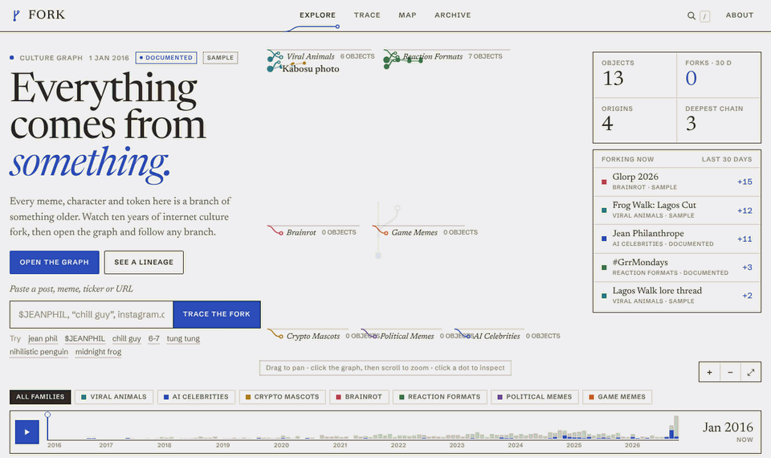

<sub>Ten years of forks in ten seconds, then: open the graph, isolate a family, follow a branch.</sub>

</div>

<br>

## Everything comes from something

A shiba photo on a blog becomes **Doge**, Doge becomes **Dogecoin**, Dogecoin becomes Twitter's logo for a week and the name of a government department. A frog in a 2005 web comic becomes a reaction image, a collectible, a hate-symbol listing, a protest icon and a memecoin. An AI "Frenchman" shadowboxing in Paris gets a token, a rival, copycats and debunk threads **in under two weeks**.

FORK draws that as what it is: **one line that keeps splitting.** Every object has at most one parent. Every screen is a view onto that single relation.

```
ONE THING  →  FORKS  →  INTO MANY THINGS
```

<table>
<tr>
<td width="50%" valign="top">

### The culture graph
Every lineage on one sheet. Each family is a plate of fork trees: origin on the left, generations branching right. Press play and watch 2016 → 2026 grow; signals run down branches forked in the last 75 days.

</td>
<td width="50%">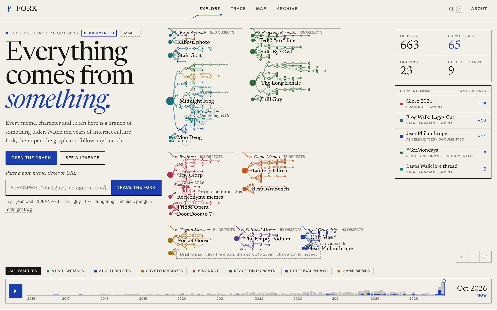</td>
</tr>
<tr>
<td width="50%">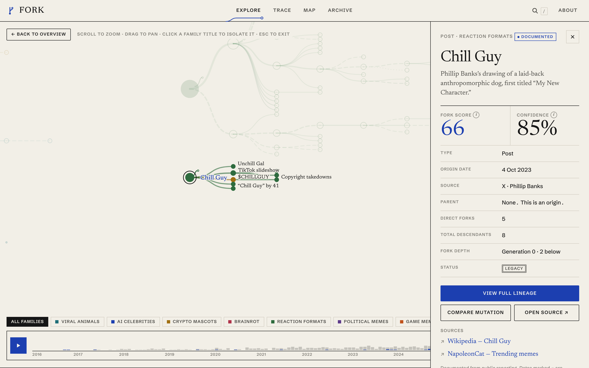</td>
<td width="50%" valign="top">

### Open the graph
The headline and panels step aside the moment you touch the graph. Zoom, pan, click a family title to isolate it, click any dot to light up its full ancestry and descendants. `Esc` brings the overview back.

</td>
</tr>
<tr>
<td width="50%" valign="top">

### Follow a lineage
Branches are honest: **thick** = influence, **solid** = verified, **dashed** = likely, **dotted** = disputed, a small **fork mark** = mutation. Click a descendant and the camera travels along the actual branch.

</td>
<td width="50%">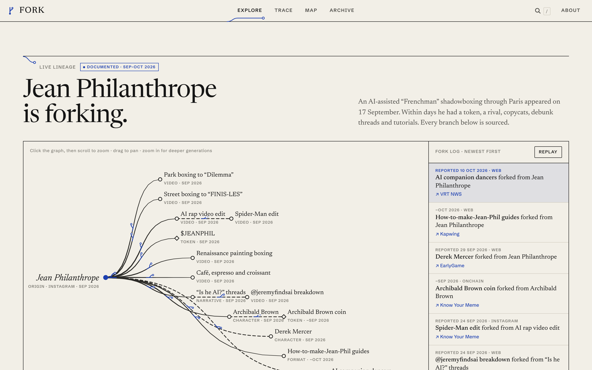</td>
</tr>
<tr>
<td width="50%">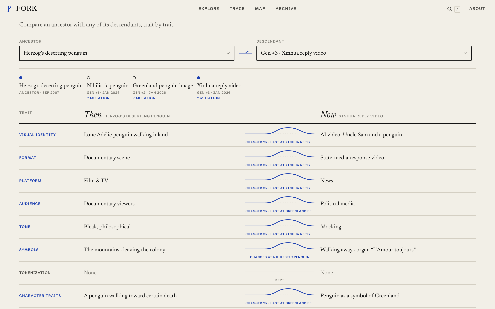</td>
<td width="50%" valign="top">

### What changed?
Pick an ancestor and any descendant. Eight traits — visual identity, format, platform, audience, tone, symbols, tokenization, character — each show whether they survived the trip and **where they broke off**.

</td>
</tr>
<tr>
<td width="50%" valign="top">

### Trace
Paste `$CHILLGUY`, `“he waits”`, `6-7` or `instagram.com/jean_philanthrope`. FORK finds the origin, the parents, the forks and the sources — and says *“not in the archive”* instead of guessing.

</td>
<td width="50%">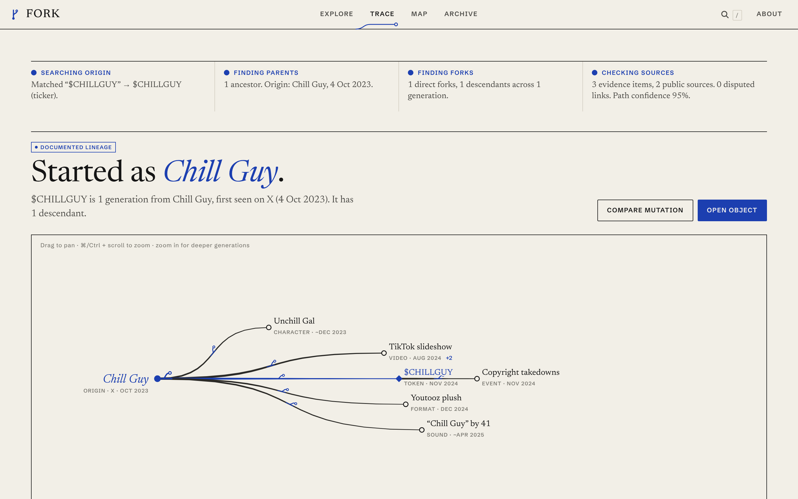</td>
</tr>
<tr>
<td width="50%">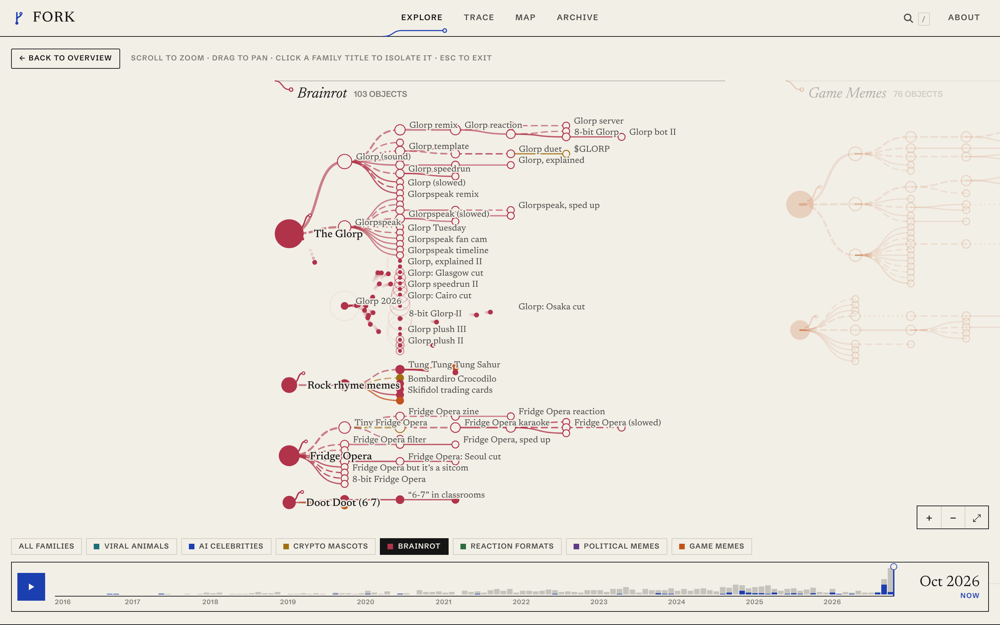</td>
<td width="50%" valign="top">

### Families
Seven cultural families — Viral Animals, AI Celebrities, Crypto Mascots, Brainrot, Reaction Formats, Political Memes, Game Memes. Forks cross between them: Doge → Dogecoin → D.O.G.E.

</td>
</tr>
</table>

<div align="center">
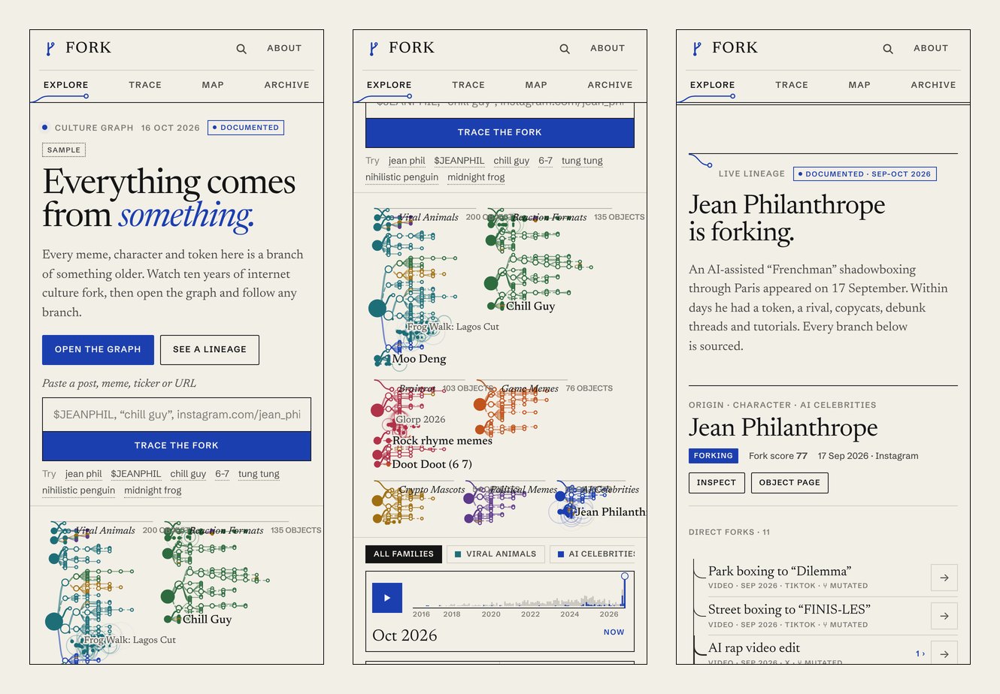
<br><sub>On a phone the graph becomes a tappable lineage stack with a bottom-sheet inspector.</sub>
</div>

<br>

## The archive at a glance

<div align="center">
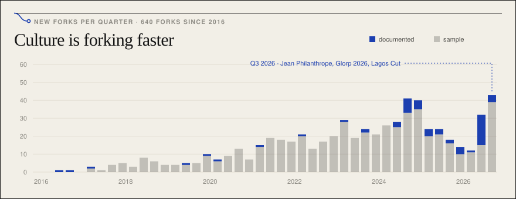
<br><br>
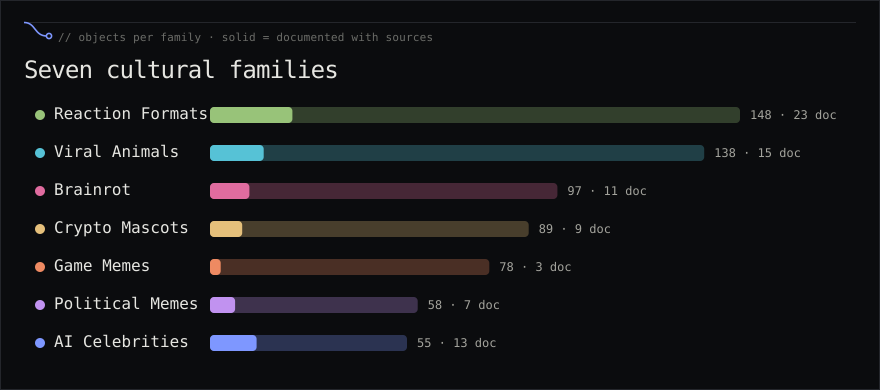
<br><br>
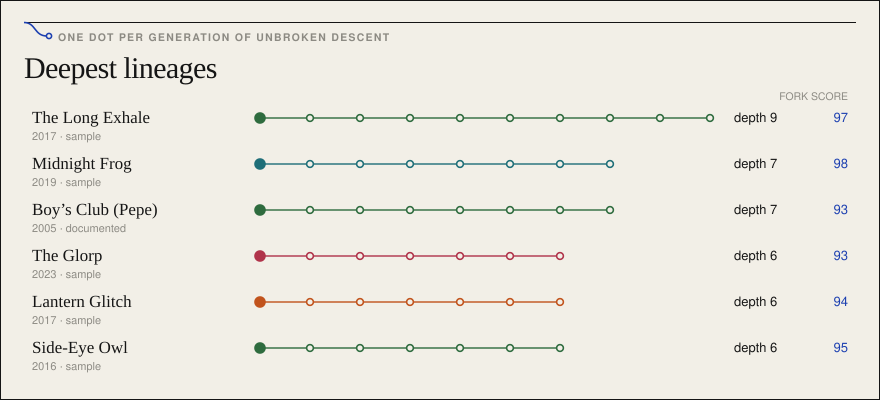
<br><br>
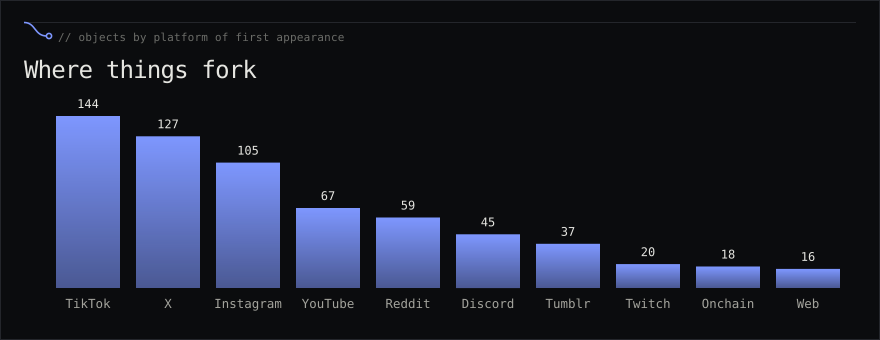
<br><sub>All charts are generated from <code>src/data.js</code> with <code>npm run charts</code>.</sub>
</div>

### A lineage, as a git graph

FORK is git for culture. Here is one documented lineage, branch by branch:

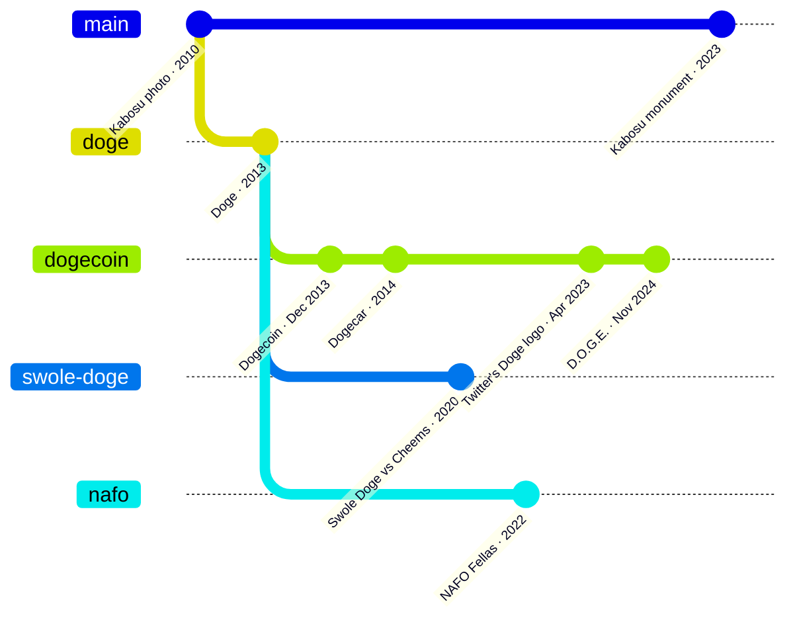

## Run it in 30 seconds

No framework, no bundler, no dependencies. It is one HTML file and four scripts.

```bash
git clone https://github.com/<you>/fork.git
cd fork
npm start            # → http://localhost:5173
```

Or open `index.html` through any static server (`npx serve .`, `python3 -m http.server`).

### Deploy your own

- **GitHub Pages** — push to `main`; the included workflow publishes the site. In *Settings → Pages* set the source to **GitHub Actions**.
- **Vercel / Netlify / Cloudflare Pages** — import the repo, no build command, output directory `/`.

## How it works

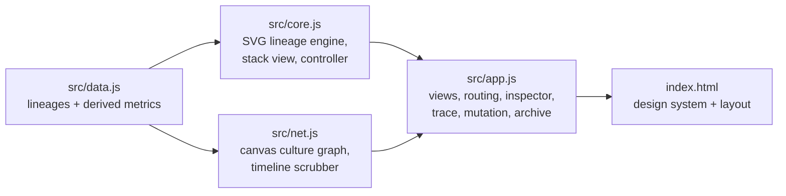

| File | What it does |
|---|---|
| `src/data.js` | The archive. Documented lineages with sources, labelled sample lineages, and everything derived from them: depth, descendants, fork score, status, momentum. |
| `src/net.js` | The homepage culture graph: plate packing, fork-tree layout, time playback, signals, hover cards, focus. Canvas, ~600 objects at 60 fps. |
| `src/core.js` | The SVG lineage engine used on object pages, trace results and the live lineage: log-time layout, tapered branches, camera that travels along branches, semantic zoom, keyboard navigation, list view. |
| `src/app.js` | Hash routing and every view: Explore, Trace, Map, Archive, Object, Mutation, About. |
| `scripts/` | `validate.cjs` (CI data checks), `charts.cjs` (README charts + banner), `serve.cjs` (zero-dep dev server). |

### Fork Score

One number for how much culture an object spawned downstream. Graph-only: **no reach, followers, views or prices.**

```
raw   = 2·forks + 0.5·descendants + 5·generations_below + 4·(platforms − 1) + 2·years_active
score = round(100 · (1 − e^(−raw / 40)))
```

### Cultural states

`ORIGIN` · `EMERGING` · `SPREADING` · `FORKING` · `PEAKING` · `COOLING` · `LEGACY` — computed from fork timing, age and score. Rules are in [docs/GRAPH_MODEL.md](docs/GRAPH_MODEL.md).

## Data you can trust

FORK mixes two kinds of objects and labels every one, everywhere.

| | Documented | Sample |
|---|---|---|
| What | Real lineages, 2005 → Oct 2026: Jean Philanthrope, Doge, Pepe, Chill Guy, Moo Deng, Italian brainrot, 6-7, the nihilistic penguin, #GrrMondays… | Fictional lineages that show how deep trees behave |
| Sources | Every object links to the reporting behind its date and its parent | None — marked **Sample** |
| Dates | Exact, `~approximate`, or *Reported* (first date a source mentions it) | Generated |
| Count | 81 | 582 |

There are no live feeds, no view counts and no prices. Trace only searches the archive; a URL outside it returns *not in the archive* rather than an invented lineage.

## Add a lineage

The best way to contribute is a new documented lineage. It takes one `R(...)` call per object in `src/data.js`:

```js
R('chill-guy', 'Chill Guy', 'POST', 'X', '2023-10-04', null, 0.85, 'reaction-formats', {
  src: ['cg'],                               // keys into SRC — title + https URL
  desc: 'Phillip Banks’s drawing of a laid-back dog, first titled “My New Character.”',
  traits: { visual: '…', format: 'Single illustration', tone: 'Laid-back', /* … */ },
  ev: [['reference', 'Posted by the artist, 4 Oct 2023']]
});
R('chillguy-token', '$CHILLGUY', 'TOKEN', 'ONCHAIN', '2024-11-15', 'chill-guy', 0.95, 'crypto-mascots', { … });
```

Then run `npm run validate`. Full guide: **[CONTRIBUTING.md](CONTRIBUTING.md)**.

## Design

Editorial on purpose: warm paper, near-black ink, one cobalt signal, a high-contrast serif (Newsreader) for names and a grotesk (Schibsted Grotesk) for metadata. The logo, the loader, the section rules, the nav underline and the origin markers are all the same gesture — **a line that forks.** Light and dark themes, keyboard navigation in every graph, `prefers-reduced-motion` respected. See [docs/DESIGN_SYSTEM.md](docs/DESIGN_SYSTEM.md) and [docs/MOTION_SYSTEM.md](docs/MOTION_SYSTEM.md).

## Roadmap

- [x] Culture graph with time playback and explore mode
- [x] Documented 2024–2026 lineages with sources
- [x] Mutation view, trace, archive, object pages, mobile stacks
- [ ] Lineage data as JSON files, one per family
- [ ] Optional live ingestion (Know Your Meme, Wikipedia changes) behind a review queue
- [ ] Shareable deep links to a camera position
- [ ] Embeddable lineage widget

## License

[MIT](LICENSE). Sources for documented objects belong to their publishers; FORK links to them and summarises in its own words.

<div align="center"><br><br><sub><i>Everything comes from something.</i></sub></div>
