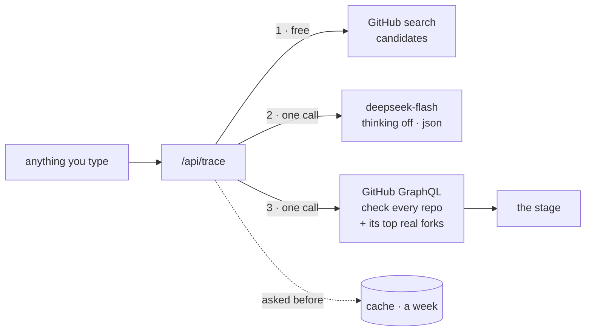

<div align="center">


# forks

### Every repository has a family tree. Some have tokens.

Type anything and watch the GitHub repositories it forked from grow into a graph — with the tokens on them: a project's own token, and coins launched here on pump.fun, whose creator fees go to the people who wrote the code.

[](https://forks.wiki)
[](LICENSE)
[](src)
[](#coins-on-repositories)
[](#fork)
[](#the-terminal)
[](https://x.com/wikifork)

</div>


| | |
|---|---|
| **Trace** | type anything — a word, a project, `owner/name` — and get the line of real GitHub repositories it came from |
| **Trade** | 100+ tokens — coins launched here, 29 project tokens, Solana's top and trending tokens — each with a terminal; you sign every trade in your own wallet |
| **Launch** | one pump.fun coin per repository; its creator fees go, for good, to the people who wrote the code |
| **Earn** | **$FORK**, pending: your X account read once, five trials, +2,000 a friend, +3,000 for connecting GitHub — and in **Season 0**, up to 1,000,000 for every coin you launch |

Four pages, one look:

| | |
|---|---|
| **[Graph](https://forks.wiki)** | The $FORK box up top (what there is to earn, and where you stand), then a prepared graph — *from git to forks*: git → bitcoin → ethereum and solana → pump.fun → this repository — then anything you type. Every point is a real repository; project tokens sit on their repos in blue, coins launched here in amber. |
| **[Market](https://forks.wiki/market)** | **Trending on forks** on top: the coins launched here that trade, by volume over the last hour, then the day. Then one list with four tabs — **On forks** (first, in amber: the official $FORK, *not launched yet* until it is, then every coin launched here), **All**, **Projects** (29 project tokens, each matched to its GitHub organization) and **Top Solana** (Jupiter's top tokens by organic score) — live price, market cap, 24 h, volume, liquidity, bonding-curve progress. A small *Create new token* button by the title. |
| **[Launch](https://forks.wiki/launch)** | Pick a repository, see who gets its creator fees, name the coin, buy at launch if you want, sign once. One coin per repository. |
| **[Guide](https://forks.wiki/guide)** | What everything is, the split, claiming, the terminal, $FORK, the commands. `/info` in the box says it in short. |

Every coin has a terminal at `forks.wiki/coin/<address>`: candles, trades, holders, the fee split, and buy/sell from your own wallet. Any Solana token with a live market opens there too, labelled as not from forks.

<table>
<tr>
<td width="68%"></td>
<td width="32%"></td>
</tr>
<tr>
<td width="68%"></td>
<td width="32%"></td>
</tr>
</table>

<sub>Screenshots from the test stand: prices, logos and coins there are stand data.</sub>

## How a question becomes a tree



1. **Candidates.** The server searches GitHub for what you typed.
2. **One model call.** `deepseek-flash`, thinking off, answers in compact json: 8–14 repositories from the origin to your answer, with the interesting branches — famous forks, ports, rewrites, successors.
3. **GitHub checks it.** One GraphQL call looks up every repository: what doesn't exist is dropped, duplicates merged, renamed repos get their current name, GitHub's own forks are marked, the origin's real parent is added above it, and notable real forks (≥ 100★) are hung on for free — up to 16 points.
4. **The stage grows it.** Probes while it looks, then the line point by point, side branches as it passes, the answer ringed. Tap any point for its card: GitHub, its forks, the network graph, *trace from here*.

Stars, years, avatars and links come from GitHub, never from the model.

## What a question costs

| | |
|---|---|
| A new question | one `deepseek-flash` call · ~700 tokens in (mostly the same brief, billed at the cache-hit rate) · ~250 out · **a fraction of a cent** |
| The same question again | **free** — answered from the CDN for a week |
| GitHub | free with a token · one search + one GraphQL call per new question |
| Abuse | new traces limited per IP (`FORKS_TRACES_PER_MIN`, default 8); DeepSeek is prepaid, so the balance is the cap |

## Run it

```bash
git clone https://github.com/forkwiki/fork.git && cd fork
GITHUB_TOKEN=… FORKS_LLM_KEY=sk-… npm start   # http://127.0.0.1:5173
```

No build step. `npm start` serves the page and runs every function in `netlify/functions` the way Netlify routes them. Only the coin launcher has dependencies (pump.fun's SDK and Solana's libraries): `npm install` once for it; without it everything else still runs.

## Deploy

The page needs its functions, so deploy with the Netlify CLI or from Git — **not** by dragging a zip into Netlify (that uploads the page without the functions).

```bash
npm install                   # the launch function's libraries, bundled from node_modules
npx netlify-cli login
npx netlify-cli link          # once: pick the site
npx netlify-cli deploy --prod
```

Set the environment variables in Netlify first, then deploy:

| Variable | |
|---|---|
| `FORKS_LLM_KEY` | DeepSeek API key (any OpenAI-compatible API works with `FORKS_LLM_URL` / `FORKS_LLM_MODEL`) |
| `GITHUB_TOKEN` | fine-grained token, public repositories read-only |
| `X_CLIENT_ID`, `X_CLIENT_SECRET`, `SESSION_SECRET`, `SUPABASE_URL`, `SUPABASE_SERVICE_ROLE_KEY`, `SITE_URL` | only for `/freeforks` |
| `SOLANA_RPC_URL` (+ `launch.treasury` in `src/config.js`) | coins on repositories and the terminal |
| `PINATA_JWT` | coins on repositories: the logo and metadata go to public IPFS through [Pinata](https://pinata.cloud) (pump.fun no longer takes uploads itself) |
| `JUP_API_KEY` | optional: Jupiter without the keyless 0.5 requests/s limit |
| `JUP_REFERRAL_ACCOUNT` | optional: forks' 0.5% on Jupiter trades — forks' Jupiter referral account (not a secret) |
| `PINATA_GATEWAY` | optional: your Pinata gateway, asked first for IPFS logos |
| `GITHUB_CLIENT_ID`, `GITHUB_CLIENT_SECRET` | optional: *connect GitHub* (a GitHub OAuth App, callback `/auth/github/callback`) + `0005_github.sql` |

`GET /api/health` lists whatever is still missing; `GET /api/chain` says whether the market and launch functions loaded the Solana SDKs (and on which Node). Step by step, in Russian: **[SETUP.ru.md](SETUP.ru.md)**.

## $FORK

The $FORK box on the graph page, or `/freeforks`:

1. **Sign in with X.** upstream reads the account first — how long it has been on X, followers, posts, lists, verified — and forks it a one-time pending allocation. The page plays the reading back line by line, then the tokens fly up into the header.
2. **Five trials**, one at a time, 9,000 together: follow, like, retweet, comment (each counted by the server five seconds after its link opens) and **quote the post with your fork card** (counted by the link to your quote: your handle, a post newer than your account, never counted twice).
3. **Your fork**: a card drawn like a repository page — the commits that made your allocation, where it came from, your invite link as a clone URL. Copy it as a picture, quote on X, save it; then the Solana wallet.

**Invite**: `forks.wiki/r/<handle>`. +2,000 $FORK, pending, for every friend who signs in through your link and finishes three trials.

**Connect GitHub** (optional, `/github`): +3,000 $FORK, once. GitHub's own OAuth with no scopes (the public profile only), done in `netlify/functions/auth-github.mjs`; the token is revoked at once. One GitHub per X account, for good; accounts younger than 30 days (`app_config 'github.min_age_days'`) don't count. It sits beside the five trials and never counts toward them or toward a referral.

A trial's link opens in a new tab or the X app. If the page reloads meanwhile, it comes back to the trials and counts the one you opened (the server's clock started when you opened it); the graph grows once a visit, not on every reload.

<table>
<tr>
<td width="50%"></td>
<td width="50%"></td>
</tr>
</table>

**Season 0 — launch coins, earn $FORK.** A pool of 200,000,000 $FORK for the people who launch coins here: nothing for a coin created alone, +1,000 when it's live with a buy at launch, then +10,000 at $10K market cap, +20,000 at $30K, +50,000 when it migrates from the curve, +100,000 at $100K, +250,000 at $500K and +569,000 at $1M — up to 1,000,000 a coin, while the pool lasts. The launch counts for the X account signed in when it was sent, or for the one that later proves the launching wallet by signing a message with it; the buy at launch is recorded from the bundle the server built and the wallet signed (it lands with the coin or not at all). Market caps are measured by the server every 10 minutes (a scheduled function: the curve on the chain, or DexScreener's consensus price with $5K+ liquidity) and a milestone counts once seen twice, 10+ minutes apart; migrating is read from the chain. Three launch rewards a day per account, accounts younger than 30 days and forks' own wallet don't earn. The ladder lives in `season_tiers`, the pool in `seasons.pool`, the rules in `app_config` (`s1.*`) — `supabase/migrations/0006_season1.sql` → `0008_season0.sql`. The board: [forks.wiki/launch#season](https://forks.wiki/launch#season).

**The official $FORK** will live on this repository, `forkwiki/fork`: nobody but forks' treasury can launch a coin on it (`config.launch.reserved`), and until it's launched the market shows it as *not launched yet* — anything called $FORK elsewhere isn't it.

Allocations are **pending**, never a balance. The X account and the post live in `src/config.js`; the amounts in the database — `tasks.reward` for the trials, `scan_lines()` and the `scan.*` / `ref.*` knobs in `app_config`. Follow along: [@wikifork](https://x.com/wikifork).

## Coins on repositories

Every repository can have one coin, launched on [pump.fun](https://pump.fun) from forks.wiki by anyone with a Solana wallet: `/launch owner/name`, **launch a coin** on any point of a tree, or the chip under a tree. Coins show up on the trees as **$TICKER** next to their repositories; `/coins` lists the newest.

The coin's **creator fees are split once, for good**, between the people behind the code and forks:

| | | |
|---|---|---|
| the owner | 70% | a person's GitHub account; an organization's part goes to its top 5 people |
| top contributors | 5% | the next two people by commits |
| up the line | 10% · 3% · 2% | the owners of the repo it forked from, and the two above — GitHub's fork record first, upstream's traced line after |
| forks | 10% | forks' wallet |

People claim on pump.fun by signing in with GitHub; nobody has to sign up first. The launcher can **buy at launch** (up to 20 SOL), first, in the same bundle. Bots and organizations get nothing (pump.fun can't pay an organization). The server decides the split from GitHub and the line; the page never sends it.

The logo and the metadata JSON go to public IPFS first, through Pinata, the way pump.fun's own docs do it (`https://ipfs.io/ipfs/<cid>`). The launch is one Jito bundle of up to three transactions — GitHub fee accounts, `create_v2` + the fee-sharing config, then `update_fee_shares_v2`, which revokes the admin — so a coin never exists without its locked split. The server holds no wallet: the launcher's wallet signs and pays, the fresh mint key co-signs after it, and every byte is checked against what the server built. A coin is listed only after the server reads that split back from the chain. Not made or endorsed by the repositories' authors; not financial advice. Owners can ask to be left out (`launch_blocklist`).

## The terminal

| | |
|---|---|
| A coin still on its pump.fun curve | traded **on the curve**: the server builds the transaction with pump.fun's SDK, the wallet signs, the server checks it byte for byte and sends it |
| Graduated coins, project tokens | traded **through Jupiter** (`/swap/v2/order` → `/execute`); SOL itself against USDC |
| Prices, market caps | DexScreener — the deepest pool among those priced where the market agrees (pools weighed by trade count, or Jupiter's price), so one broken pool can't skew it; coins it hasn't seen yet are priced from their curve |
| Logos | Jupiter's token list, then DexScreener, then the project's GitHub avatar; logos on IPFS through `/api/ipfs/<cid>` |
| Trending, top | Jupiter's Tokens API: trending over 1 h, top by organic score over 24 h (verified or high organic activity, never flagged, with a logo); GeckoTerminal's trending pools if Jupiter doesn't answer |
| Any other token | any Solana address with a live market opens in the terminal, labelled *not on forks* |
| Candles, trades | GeckoTerminal (1m · 5m · 15m · 1h · 4h · 1d); a coin on its curve straight from the chain (the curve's own transactions) until GeckoTerminal has caught up |
| Holders, balances, curve progress | our RPC |

**forks' fee: 0.5%** on every trade made here and on the buy at launch (`config.trade.feeBps`). On a curve it's a SOL transfer to forks' treasury in the same transaction; through Jupiter it's Jupiter's referral fee (with `JUP_REFERRAL_ACCOUNT`; Jupiter keeps a fifth of it). The quote shows it before you sign. The server never holds a key and never decides an amount: the wallet signs what the page shows.

## Inside

```
index.html · market.html · coin.html · launch.html · guide.html     the pages
css/forks.css            one stylesheet: tokens (dark and light), every component
src/
  prompt.js              upstream's brief and its json — shared by the server and the Claude artifact
  brain.js               routing, which brain the page has, the GitHub-only fallback
  stage.js               the growing tree
  shell.js               the header, tabs, search, wallet menu and footer of every page
  app.js · showcase.js   the graph page: the showcase, input, results, tokens on trees, the point card
  market.js · coin.js    the market list; a coin's terminal: chart, trades, holders, buy/sell
  launchpage.js          the launch page around the launch form
  quest.js · config.js   /freeforks, /invite and every public setting
  card.js                your fork as a picture: drawn on a canvas, copied, quoted
  launch.js · wallet.js  coins on repositories: the split, the logo, the launch; Solana wallets (Wallet Standard)
  season.js              Season 0: the ladder, your coins, the top devs, linking a wallet by its signature
netlify/
  functions/trace.mjs    one request → one answer: candidates, one model call, the check, the cache
  functions/repos.mjs    GitHub for the fallback
  functions/auth-*.mjs · api.mjs    sign in with X (and who invited you), connect GitHub, the trials
  lib/github.mjs · lineage.mjs      GitHub GraphQL and search; proposal → tree of real repos
  functions/launch.mjs   the plan, the bundle, the status, the coins on a tree
  functions/market.mjs   the market, one coin, candles, trades, holders, balances, quotes, trades
  functions/ipfs.mjs     IPFS logos through several gateways, images only, cached for good
  functions/season.mjs · season-tick.mjs · lib/season.mjs    Season 0: the board, wallet links; every 10 minutes the market caps
  lib/markets.mjs        DexScreener, GeckoTerminal, Jupiter (quotes, swaps, token logos, trending and top lists)
  lib/split.mjs · chain.mjs         who gets the fees; IPFS (Pinata), pump.fun transactions, Jito, reading them back
supabase/migrations/     the database, closed to anon: 0001 → 0002 (scan) → 0003 (invites, trials) → 0004 (coins) → 0005 (GitHub) → 0006–0008 (Season 0)
og/                      link-preview cards, one per page (a new file name per version, so chats fetch the new one)
fonts/                   Anybody and JetBrains Mono, self-hosted (OFL)
docs/brand/              the X avatar (400, 800; a dark one too) and header (1500×500, 3000×1000), the pages they're drawn from, Mona Sans (OFL)
```

More: [docs/UPSTREAM.md](docs/UPSTREAM.md) · [docs/DESIGN_SYSTEM.md](docs/DESIGN_SYSTEM.md) · [docs/DECISIONS.md](docs/DECISIONS.md) · [CHANGELOG.md](CHANGELOG.md)

## License

[MIT](LICENSE). Repository data comes from GitHub's API; forks links to every repository it shows.

Not financial advice. forks is not affiliated with GitHub, pump.fun, Jupiter or the projects shown; project tokens belong to their projects.

<div align="center"><br><br><sub><i>everything forks from something.</i></sub></div>
